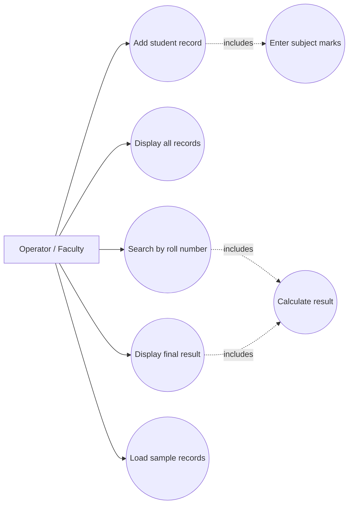
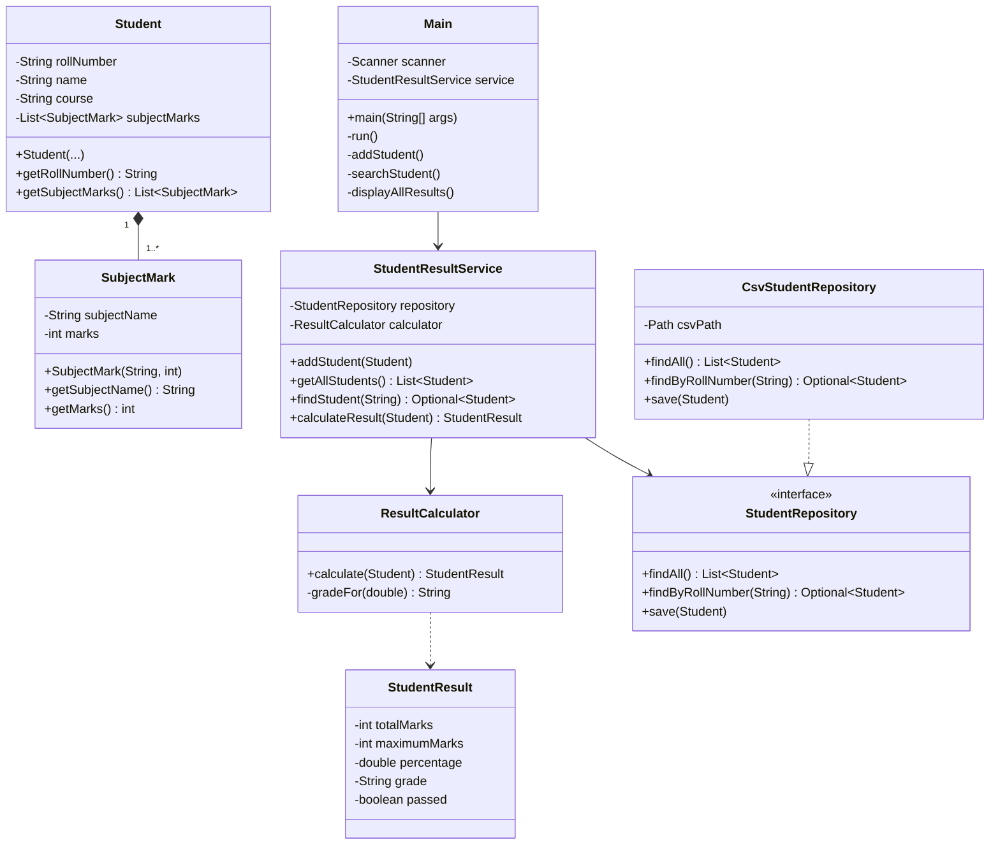
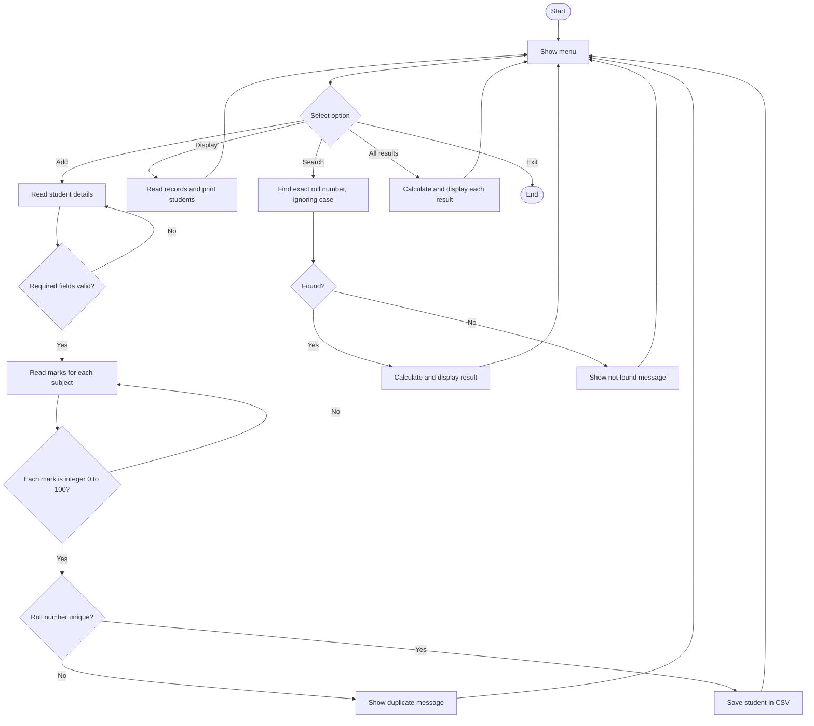
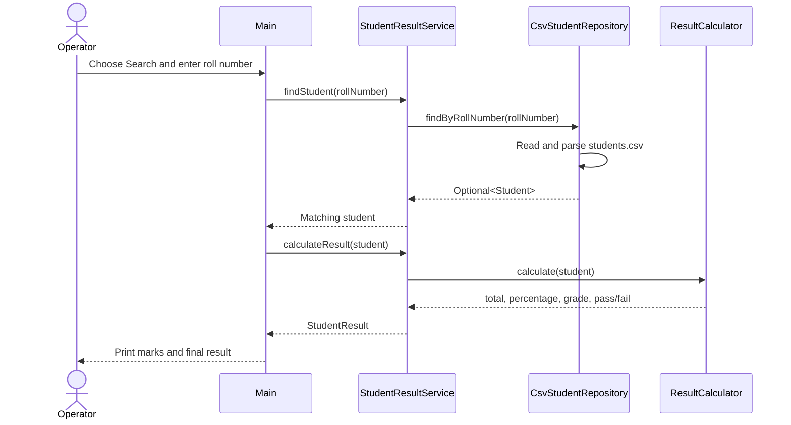
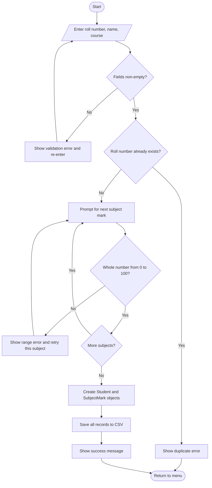

# Student Result Management System

**Mini Project Report for Object Oriented Programming Lab**

**Student:** [Enter your name]  
**Roll Number:** [Enter your roll number]  
**Course / Semester:** [Enter course and semester]  
**Institution:** [Enter college name]  
**Academic Year:** [Enter academic year]

## Abstract

The Student Result Management System is a Java console application for recording student information and subject-wise examination marks. Manual calculation and scattered records can make result preparation slow and inconsistent. This project provides a menu-driven program that validates student details and marks, saves records in a local CSV file, and calculates totals, percentages, grades, and pass/fail status. The program uses object-oriented classes, constructors, encapsulated fields, collections, methods, conditional statements, and file handling. Faculty or an operator can add a student, display all students, search by roll number, and display individual or overall results. The implementation uses Java 17 or later and requires no external database or libraries, which keeps it suitable for an introductory OOP laboratory project.

## 1. Introduction

Educational institutions need accurate records of student marks and final results. In a small class, marks may be kept in notebooks or separate spreadsheets and totals may be calculated by hand. This approach takes time and can introduce arithmetic or transcription mistakes. A simple computer-based system can keep the information together and apply the same calculation rules for every student.

This project was selected to apply Java object-oriented programming concepts to a familiar academic task. It models students, subjects, and results as separate classes and gives a user a menu for common operations. Its purpose is to make a small result-record workflow easier to demonstrate, understand, and extend in a laboratory setting.

## 2. Problem Statement

The project addresses the manual and fragmented handling of student marks. A user needs a consistent way to enter student identity details and subject marks, find a record by roll number, see all records, and calculate a final result without repeating calculations by hand. The application must reject missing required details, duplicate roll numbers, and marks outside the permitted range.

## 3. Objectives

- Create and store a student record with a unique roll number, name, course, and subject marks.
- Display all saved student records.
- Search for a record by roll number, ignoring letter case.
- Validate required fields and accept only whole-number marks from 0 to 100.
- Calculate total marks and percentage for each student.
- Assign a grade from the percentage and determine pass/fail from subject pass marks.
- Demonstrate classes, objects, constructors, encapsulation, collections, methods, and conditional statements.
- Preserve records between program runs using a local CSV file.

## 4. Existing System

The existing approach for a small class may use handwritten registers, individual spreadsheets, or manual calculation. It is easy to start, but records can be duplicated, searching can take time, and repeated arithmetic can produce inconsistent results. A manual record also does not automatically enforce a common mark range or pass rule. The proposed program provides a small, consistent workflow for these tasks.

## 5. Proposed System

The proposed application presents a menu in the terminal. The operator can add a student, list students, search by roll number, view all results, inspect the grading rules, or load sample records. Student and subject values are validated before they are saved. `CsvStudentRepository` reads and writes the records file, while `StudentResultService` coordinates repository access and calculation. `ResultCalculator` derives the student's total, percentage, grade, and pass/fail status. The CSV file is human-readable and avoids requiring a database server for this scope.

## 6. Scope of the Project

### Included

- One operator using a local command-line application.
- Five predefined subjects: English, Mathematics, Physics, Chemistry, and Computer Science.
- Each subject is marked out of 100.
- Add, list, and search student records.
- Individual search result and full-class result display.
- Local CSV persistence and starter sample records.
- Input validation for required text fields, duplicate roll numbers, and marks.

### Outside the current scope

- Multiple user accounts, authentication, and role permissions.
- Web or mobile interface, network access, and concurrent editing.
- Database server, backups, analytics dashboards, or export to PDF.
- Editing or deleting an existing student record.
- Configuring a different number of subjects at runtime.

## 7. Hardware and Software Requirements

| Category | Requirement |
|---|---|
| Hardware | A computer with a keyboard, display, and at least 2 GB RAM |
| Operating system | Windows, macOS, or Linux |
| Language | Java |
| JDK | JDK 17 or later |
| IDE | IntelliJ IDEA, Eclipse, or Visual Studio Code (optional) |
| Database | Not required; records use UTF-8 CSV file storage |
| Tools | Terminal / command prompt, Java compiler (`javac`), Git (for collaboration) |

## 8. System Design

### 8.1 Use Case Diagram

The operator can add records, view stored data, search and display results, and load examples. Adding a record includes entering subject marks; displaying results includes calculating the student's result.



Source: [use-case.mmd](diagrams/use-case.mmd)

### 8.2 Class Diagram

The `Student` class owns an immutable collection of `SubjectMark` objects. The service depends on the `StudentRepository` interface, so CSV persistence stays separate from menu interaction and result calculation.



Source: [class-diagram.mmd](diagrams/class-diagram.mmd)

### 8.3 Activity Diagram

The activity diagram shows the menu, validation loops, storage, and the alternate search outcome when a roll number is not found.



Source: [activity-diagram.mmd](diagrams/activity-diagram.mmd)

### 8.4 Sequence Diagram

The sequence diagram follows a search request from the operator through the UI, service, CSV repository, and result calculator.



Source: [sequence-diagram.mmd](diagrams/sequence-diagram.mmd)

## 9. Modules Description

| Module / Class | Responsibility |
|---|---|
| `Main` | Displays the menu, reads and validates console input, and formats records and results. |
| `Student` | Holds roll number, name, course, and an unmodifiable list of subject marks. |
| `SubjectMark` | Holds one subject name and marks; checks the 0-100 range. |
| `StudentResult` | Carries the calculated total, maximum, percentage, grade, and pass flag. |
| `ResultCalculator` | Calculates results and applies the project's grade and pass rules. |
| `StudentRepository` | Defines the operations for reading, searching, and saving student data. |
| `CsvStudentRepository` | Implements local CSV loading and saving, including duplicate checks. |
| `StudentResultService` | Coordinates repository operations and calls the result calculator. |

## 10. Algorithm and Flowchart

### 10.1 Add Student Algorithm

1. Start and display the menu.
2. Read the roll number, name, and course.
3. Repeat the prompt for any required text that is blank.
4. Search existing records; if the roll number is already used, show an error and return to the menu.
5. For each predefined subject, read a whole-number mark.
6. If a mark is not an integer from 0 through 100, show an error and repeat that subject prompt.
7. Construct `SubjectMark` objects and a `Student` object.
8. Save the student with the existing records in `data/students.csv`.
9. Show a success message and return to the menu.

### 10.2 Calculate Result Algorithm

1. Set total marks to zero and maximum marks to subject count multiplied by 100.
2. Add each subject mark to the total.
3. Calculate percentage as `total / maximum * 100`.
4. Assign grade: A+ for 90 or higher; A for 80-<90; B for 70-<80; C for 60-<70; D for 50-<60; E for 40-<50; otherwise F.
5. Check every subject mark; the student passes only if all marks are at least 40.
6. Display subject-wise marks, total, percentage, grade, and pass/fail status.

### 10.3 Add Student Flowchart



Source: [add-student-flowchart.mmd](diagrams/add-student-flowchart.mmd)

## 11. Implementation

The code is under `src/main/java/com/college/result/`. Private fields and public getters demonstrate encapsulation. Constructors validate objects before they can be used. The application uses `List` collections and Java streams for aggregation and pass checks. The repository interface separates storage from the service; its CSV implementation writes a replacement file to a temporary path before moving it into place. The program logic is presented in the source files in the repository; `Main`, `Student`, `ResultCalculator`, and `CsvStudentRepository` are the main files to review during a lab demonstration.

### Important Source Code

The calculation method totals the marks, computes percentage, checks every subject against the pass mark, and returns one result object:

```java
public StudentResult calculate(Student student) {
    int total = student.getSubjectMarks().stream()
            .mapToInt(SubjectMark::getMarks).sum();
    int maximum = student.getSubjectMarks().size() * SubjectMark.MAX_MARKS;
    double percentage = (total * 100.0) / maximum;
    boolean passed = student.getSubjectMarks().stream()
            .allMatch(mark -> mark.getMarks() >= PASS_MARK);
    return new StudentResult(total, maximum, percentage,
            gradeFor(percentage), passed);
}
```

The constructor applies basic validation and stores a defensive, unmodifiable copy of the marks list:

```java
public Student(String rollNumber, String name, String course,
               List<SubjectMark> subjectMarks) {
    this.rollNumber = requireText(rollNumber, "Roll number");
    this.name = requireText(name, "Student name");
    this.course = requireText(course, "Course");
    Objects.requireNonNull(subjectMarks, "Subject marks cannot be null");
    if (subjectMarks.isEmpty()) {
        throw new IllegalArgumentException("Subject marks are required.");
    }
    this.subjectMarks = Collections.unmodifiableList(
            new ArrayList<>(subjectMarks));
}
```

### Result rules

- Maximum per subject: 100.
- Pass mark: 40 in every subject.
- Total: sum of the marks for all configured subjects.
- Percentage: `(total marks / maximum marks) * 100`.
- Grade bands: A+ (>=90), A (>=80), B (>=70), C (>=60), D (>=50), E (>=40), F (<40).
- Pass/fail is independent of grade: a student fails if any subject is below 40.

## 12. Results and Test Cases

The following cases and sample calculations use five subjects, each out of 100. This authoring environment does not have a JDK available on `PATH`, so runtime observations are marked pending instead of being reported as executed. Compile and exercise the cases locally using the commands in Appendix A before submitting the report as a completed, verified project.

| ID | Test case | Expected result | Actual result |
|---|---|---|---|
| T01 | Load sample records into an empty file | Three sample students are saved | Pending runtime execution |
| T02 | Display all results for sample records | Show all marks, totals, percentages, grades, and statuses | Calculated from sample marks: STU101 450/500, 90.00%, A+, PASS; STU102 393/500, 78.60%, B, PASS; STU103 302/500, 60.40%, C, FAIL because Physics is 39. Confirm by running the program. |
| T03 | Search for an existing roll number | Display the matching student's details and result | Pending runtime execution; expected STU101 result is 450/500, 90.00%, A+, PASS |
| T04 | Search for an unknown roll number | Display a clear not-found message without terminating | Pending runtime execution |
| T05 | Enter an out-of-range mark (101), then a valid mark | Reject 101 and repeat the same subject prompt | Source logic handles values outside 0-100; confirm interactively |
| T06 | Add a duplicate roll number | Prevent saving a second student with the same roll number | Source logic checks for an existing roll number; confirm interactively |
| T07 | Restart application after saving records | Previously saved data remains readable | Pending runtime execution |

### Representative Console Output

The following is a representative output layout based on the sample data; it is not a captured runtime screenshot. A readable copy is available in `docs/screenshots/sample-console-output.txt`.

```text
Student: Aarav Sharma | Roll: STU101 | Course: BSc Computer Science
English                92 / 100
Mathematics            88 / 100
Physics                85 / 100
Chemistry              90 / 100
Computer Science       95 / 100
Total: 450 / 500 | Percentage: 90.00% | Grade: A+ | Status: PASS
```

## 13. Conclusion

The Student Result Management System implements the requested student record, subject mark, search, total, percentage, grade, and pass/fail operations. It validates input, stores the class records in CSV, and applies one consistent result rule. The project also demonstrates core OOP ideas through its domain classes, encapsulated state, constructors, interface-based repository, service layer, and calculation methods. Its small scope makes the application suitable for a lab demonstration and leaves room for further development.

## 14. Future Scope

- Add update and delete operations with an audit trail.
- Support configurable subjects, maximum marks, and pass thresholds.
- Replace CSV with a relational database using JDBC.
- Add student and faculty login with role-based permissions.
- Provide a graphical or web interface and printable result sheets.
- Add sorting, class statistics, backup/restore, and CSV import/export.
- Add automated unit and integration tests for calculation and persistence rules.

## 15. References

- Oracle, *Java Platform, Standard Edition Documentation*: https://docs.oracle.com/en/java/
- Oracle, *Java SE 17 Documentation*: https://docs.oracle.com/en/java/javase/17/
- Java SE 17 API, `java.util.List`: https://docs.oracle.com/en/java/javase/17/docs/api/java.base/java/util/List.html
- Java SE 17 API, `java.nio.file.Files`: https://docs.oracle.com/en/java/javase/17/docs/api/java.base/java/nio/file/Files.html
- Java SE 17 API, `java.util.Scanner`: https://docs.oracle.com/en/java/javase/17/docs/api/java.base/java/util/Scanner.html
- Course notes and laboratory instruction for Object Oriented Programming.

## Appendix A: Compile and Run

```bash
javac -d out src/main/java/com/college/result/*.java
java -cp out com.college.result.Main
```

The first run creates `data/students.csv` when a record is added. Choose menu option 6 to add example records to an empty data file.

## Appendix B: Flowchart Source

All UML and flowchart sources are stored as Mermaid files in `docs/diagrams/` and can be previewed in GitHub or any Mermaid-compatible editor.
